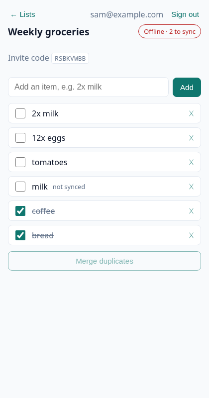
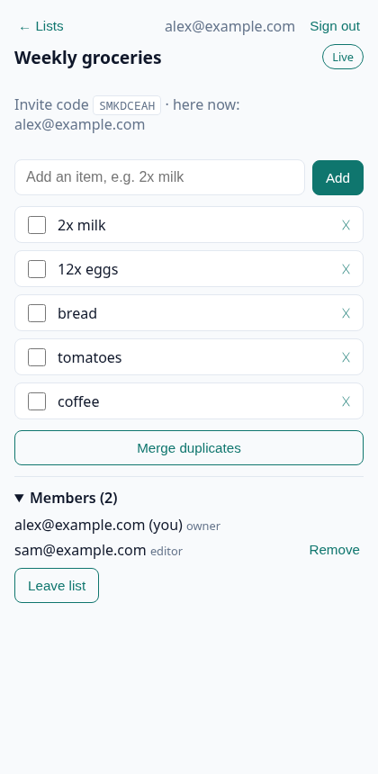
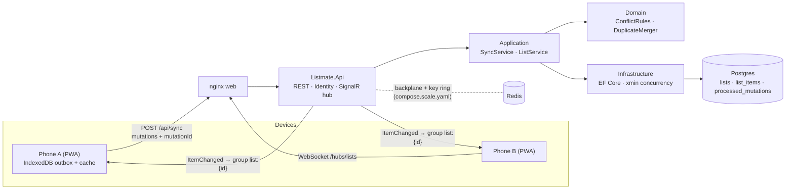

# Listmate

[](https://github.com/ahmedoshelmy/listmate/actions/workflows/ci.yml)
[](LICENSE)
[](https://dotnet.microsoft.com/)
[](https://react.dev/)

Part of the [systems portfolio](https://github.com/ahmedoshelmy/systems-portfolio).

**Shared lists that update live on every phone and keep working offline.** Groceries, packing, chores: tick items in
the supermarket basement with no signal and they sync when you are back online, without overwriting what your
partner changed in the meantime.

.NET 10 · ASP.NET Core · SignalR · EF Core + PostgreSQL · ASP.NET Core Identity · React PWA (IndexedDB outbox) ·
Testcontainers · OpenTelemetry · Docker Compose

 

## What it does

- **Accounts and sharing.** Register, create a list, share its 8-letter invite code; whoever enters it joins.
- **Real time.** Everyone with the list open sees adds, ticks and deletes as they happen, and who else is there.
- **Offline first.** Changes are queued in IndexedDB and shown immediately; the queue replays when the device is
  back online, and a reconnecting device fetches everything it missed since its last known version.
- **Exactly once.** Every change carries a client `mutationId`; replaying a batch (flaky network, double tap, two
  tabs) never applies anything twice.
- **Sensible merges.** Per-field last-writer-wins: your tick and my rename of the same item both survive. Delete wins
  over edit.
- **Merge duplicates.** `2x milk` + `milk` becomes `3x milk` with one tap.
- **Members.** See who is on a list; leave it, or (as the owner) remove someone. Access ends at once and their
  open screens are told live. An owner who leaves hands over; the last one out deletes the list.

## Architecture

One service with Clean Architecture layers — deliberately no microservices or broker
([ADR 0002](docs/adr/0002-monolith-without-a-broker.md)).



| Project | Responsibility |
|---|---|
| `src/Listmate.Domain` | `SharedList` (members, invite code, version counter), `ListItem`, `ItemText` parser, `ConflictRules`, `DuplicateMerger`. No dependencies. |
| `src/Listmate.Application` | `SyncService` (idempotent batch with retry on conflict), `ListService`, ports `IListStore` and `IListNotifier`, FluentValidation. |
| `src/Listmate.Infrastructure` | `ListmateDbContext` (Identity + lists), `EfListStore`, migrations, `xmin` row versions. |
| `src/Listmate.Api` | Minimal API endpoints, Identity API endpoints, `ListsHub` + presence, ProblemDetails, health, OpenTelemetry. |
| `src/Web` | React + Vite PWA: outbox, list cache, live view, online/offline indicator, service worker. |

The full protocol (mutations, statuses, versions, conflict rules, resync) is in
**[docs/sync-protocol.md](docs/sync-protocol.md)**.

## Quickstart

Needs Docker (or Podman with the Docker CLI).

```bash
cp .env.example .env            # optional: set LISTMATE_DEMO_DATA=true and a LISTMATE_DEMO_PASSWORD
docker compose up -d --build --wait
# open http://localhost:8080 for the PWA; the API is also on http://localhost:5180
scripts/smoke.sh                 # two users, one shared list, an item added by one and read by the other
docker compose down -v
```

With demo data on, sign in as `alex@example.com` or `sam@example.com` (password from your `.env`) to find
"Weekly groceries" and "Beach trip packing" already shared between them. Open the same list in two browsers,
switch one to offline in dev tools, tick a few items, go back online, and watch the other one catch up.

Traces and metrics: `OTEL_EXPORTER_OTLP_ENDPOINT=http://aspire-dashboard:18889 docker compose --profile obs up -d`,
then the Aspire dashboard on http://localhost:18888.

### Scale-out: two replicas, one Redis

```bash
docker compose -f compose.yaml -f compose.scale.yaml up -d --build --wait
(cd src/Web && npm ci) && node scripts/scale-smoke.mjs
docker compose -f compose.yaml -f compose.scale.yaml down -v
```

nginx round-robins over two API replicas with no sticky sessions (the PWA connects with WebSockets and skips the
negotiate request). Redis carries SignalR group messages between replicas and holds the shared Data Protection key
ring, so a token issued by one replica works on the other. `scale-smoke.mjs` proves both: it signs in on replica B,
calls replica A with that token, connects a hub client to A and writes through B.

### Local development

```bash
docker compose up -d postgres
dotnet run --project src/Listmate.Api   # http://localhost:5180, migrates on start
cd src/Web && npm ci && npm run dev      # http://localhost:5173, proxies /api and /hubs to the API
```

The API reads `ConnectionStrings__Postgres` (default compose credentials work with
`Host=localhost;Database=listmate;Username=listmate;Password=listmate` when you publish the Postgres port).

### Tests

```bash
dotnet test                               # unit + Testcontainers integration tests (needs Docker)
cd src/Web && npm test                    # outbox, list state and parser tests
```

- **Unit tests:** item text parsing, merge `2x milk` + `milk`, every conflict rule, replayed `mutationId` is a no-op,
  stale `baseVersion` merges, retry on concurrency conflicts, validation, presence, leave/remove rules, and the Clean Architecture
  dependency rule.
- **Integration tests** (real Postgres in a container, API in-process, real SignalR client): user B receives
  `ItemChanged` when user A ticks an item; an offline batch of five mutations replayed twice — two copies racing,
  then a third — is applied once; resync with `changes?since=N` returns tombstones; strangers get 404/401; a removed
  member is told live and gets no further pushes; leaving hands over and the last one out deletes the list; the
  retention sweep prunes only old mutation ids.

## API sketch

| Method | Path | |
|---|---|---|
| POST | `/api/auth/register`, `/api/auth/login`, `/api/auth/refresh` | Identity API endpoints (bearer tokens) |
| GET / POST | `/api/lists` | My lists / create a list |
| POST | `/api/lists/join` | Join with `{ "inviteCode": "ABCDEFGH" }` |
| GET | `/api/lists/{id}` | Snapshot: list, version, items |
| GET | `/api/lists/{id}/changes?since=N` | Items changed after version N, tombstones included |
| GET | `/api/lists/{id}/members` | Members with role; `isYou` marks the caller |
| POST | `/api/lists/{id}/leave` | Leave (owner hands over; last one out deletes the list) |
| DELETE | `/api/lists/{id}/members/{userId}` | Owner removes a member (403 for editors) |
| POST | `/api/lists/{id}/merge-duplicates` | Fold duplicate open items |
| POST | `/api/sync` | Apply a batch of mutations exactly once |
| WS | `/hubs/lists` | `JoinList(id)`, `LeaveList(id)`; server sends `ItemChanged`, `PresenceChanged`, `MemberJoined`, `MemberLeft` |
| GET | `/health/live`, `/health/ready` | Liveness; readiness includes the database |

## Interview talking points (design notes)

1. **Offline sync without a CRDT.** The client outbox stores intent mutations with idempotency keys and client-chosen
   item ids. The server applies a batch in one transaction together with a `processed_mutations` row per id, so a
   replay is a primary-key lookup, not guesswork. Conflicts resolve per field in server order; delete wins. Why this
   and not Automerge/Yjs: [ADR 0003](docs/adr/0003-sync-protocol-lww-not-crdt.md).
2. **Optimistic concurrency that serialises per list.** Every change bumps the list's version, so two batches racing
   on one list collide on Postgres' `xmin` row version; the loser discards its unit of work, re-reads and retries
   (bounded). The integration test fires the same batch twice in parallel and checks it lands once.
3. **Never lose a message.** SignalR pushes are hints, the database is the truth. Each list has a gap-free version
   counter; a device's bookmark only moves on snapshot/changes responses, so after any reconnect
   `GET changes?since=N` repairs whatever the socket missed, deletes included.
4. **A monolith on purpose, and it still scales out.** One bounded context, one transaction per batch: no broker, no
   saga, no eventual consistency to explain. Scale-out is SignalR's Redis backplane plus shared Data Protection
   keys behind a round-robin balancer, demonstrated by `compose.scale.yaml` and checked in CI
   ([ADR 0002](docs/adr/0002-monolith-without-a-broker.md)).
5. **Framework auth, done properly.** Identity API endpoints give register/login/refresh with bearer tokens; the hub
   reads the token from the query string only on `/hubs` ([ADR 0004](docs/adr/0004-identity-api-endpoints.md)).
6. **Idempotency has a shelf life.** The `processed_mutations` log would grow forever, so a `BackgroundService` on a
   `PeriodicTimer` (driven by `TimeProvider`) prunes rows past a configurable window with one set-based
   `ExecuteDeleteAsync`. Every replica may run it — the delete is idempotent — and the trade-off (a device offline
   longer than the window could replay) is written down in [docs/sync-protocol.md](docs/sync-protocol.md).
7. **Revoking access in a real-time app.** Removing a member is a domain rule (only the owner; never yourself; an
   owner who leaves hands over), but the hard part is the socket: the server tells the group, then evicts that
   person's connections from the SignalR group so no further pushes reach them, and every REST/sync call re-checks
   membership anyway.
8. **Clean Architecture you can test.** The domain is plain C#; the application layer depends on two ports, so the
   sync rules are unit-tested with an in-memory store, and the architecture test fails the build on a layer leak.

## Azure (optional)

`infra/main.bicep` describes Azure Container Apps (consumption) for the API and the web front, Postgres Flexible
Server (B1ms) and, with `enableRedis=true`, Azure Cache for Redis (Basic C0, not free) so the API can run up to three
replicas. Deployment is manual and optional; CI only compiles the Bicep. It has not been deployed: the images need
pushing to a registry, and the web's nginx upstream (`api:8080`) must point at the API app's internal ingress.

## Status

MVP and the scale-out profile are done and run in Compose and in CI. Next steps: presence in Redis (it is per replica
today), a Flutter client, recurring lists, and an optional free-model
"sort into aisles".

Known limits: with several replicas, presence only lists people connected to the same replica; concurrent edits of the same item name keep the last one; a removed member's live connections are evicted
only on the replica that handled the removal (their REST and sync calls are refused everywhere).

## Extracted from Lingo

Listmate is extracted from **Lingo**, a private personal-assistant app, where shared to-do and grocery lists, the
"merge duplicates" action and the phone's offline outbox were first written in TypeScript and Dart. This repository
is a clean re-implementation in .NET and React with a fresh history and invented sample data only.

## License

[MIT](LICENSE)
